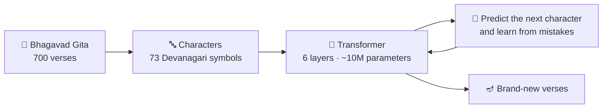

<div align="center">

# 🪔 shloka-gpt

### *A tiny GPT that learns Sanskrit from the Bhagavad Gita, from scratch*

**धर्मक्षेत्रे कुरुक्षेत्रे समवेता युयुत्सवः।**


</div>

---

## ✨ The idea

> **Can a small neural network, given nothing but the raw text of the Gita, discover the rules of Sanskrit on its own?**

No pre-trained model. No grammar rules. No dictionary.
The model starts knowing nothing, not even what a letter is, and learns purely by reading all **700 verses**, one Devanagari character at a time.

Sanskrit makes this a fascinating test:

| 🔗 **Sandhi** | Words fuse together at their edges, so there are no clean word boundaries to lean on |
|---|---|
| 🎼 **Metre** | Verses follow strict rhythms like the *anuṣṭubh*: four quarters of eight syllables |
| ✍️ **Script** | Devanagari builds syllables from consonants, vowel signs and conjuncts |

---

## 🧠 How it works



| | |
|---|---|
| **Model** | GPT-style Transformer, written from scratch in ~100 lines of plain PyTorch |
| **Tokens** | Single characters, so the model must discover syllables and words itself |
| **Data** | ~66,000 characters of the Gita in Devanagari |
| **Size** | ~10.8 million parameters (6 layers, 6 attention heads) |

---

## 🪔 Verses composed by the model

None of these verses exist in the Gita. They were written character by character by the trained model:

```text
अर्जुन उवाच
क्ष्यमुक्षाणं पात्मनसंशयोर्तगां संजगयम्।
सृहस्त्वभूता स्वभूतात्ममनः कौन्तेय श्रीप्रलयात्मुपः।।2.28।।

देवादिह्य वाद्योगेश च सर्वति मच्छन्ति चैव योगी त्।
सच्छामार्थं ते तद्वेषु योगस्वभूयः प्रकृतिष्ठताः।।2.29।।

सोऽहमावीनुप्ति मां तामां निव्यस्य कर्मिदः।
निर्माणि निराणीन्निर्ते जन्मन्ति मे न प्रलियम्।।2.67।।
```

The words are mostly invented, but look at what the model discovered **on its own**, with no grammar rules given:

- ✅ the two-line verse shape, closed with `।` and `।।` and a verse number
- ✅ speaker lines: `अर्जुन उवाच` ("Arjuna said")
- ✅ real Gita vocabulary: `कौन्तेय` (Kaunteya), `योगी` (yogi), `कर्म` (karma), `सोऽहम्` (so'ham)
- ✅ Sanskrit word endings and joins, like `-आत्मनः`, `-ष्ठताः`, `-न्ति`
- ✅ valid Devanagari syllables and conjunct consonants throughout

## 📈 Training: learning vs memorising

With only 700 verses, the biggest challenge was stopping the model from simply **memorising** the Gita.

| Run | Steps | Train loss | Val loss | What happened |
|---|---|---|---|---|
| Long run | 5000 | 0.045 | 4.543 | ❌ Memorised the text; got worse on unseen verses after ~500 steps |
| Final run | 600 | 1.578 | **1.913** | ✅ Learned patterns, best score on unseen verses |

*Train loss* measures verses the model studied; *val loss* measures verses it never saw. When train loss keeps falling but val loss rises, the model is reciting rather than learning. The training script now automatically keeps the checkpoint with the best val loss.

Trained on an NVIDIA GPU in about 15 minutes.

---

## 🚀 Run it yourself

```bash
pip install torch
python train.py            # full training (NVIDIA GPU recommended)
python train.py --small    # quick test on any laptop CPU
python sample.py           # compose new verses
```

<details>
<summary><b>📁 Project structure</b></summary>

```
shloka-gpt/
├── model.py     ← the Transformer, built from scratch
├── train.py     ← teaches the model on the Gita
├── sample.py    ← asks the model to compose new verses
└── data/
    └── gita.txt ← all 700 verses in Devanagari
```

</details>

---

## 🗺️ Roadmap

- [x] Character-level GPT built from scratch
- [x] Training pipeline on the full Bhagavad Gita
- [x] Detect memorisation and keep the best checkpoint automatically
- [ ] Compare early vs late training to see *when* metre emerges
- [ ] Syllable-level tokens instead of characters
- [ ] Train on more classical texts: Upanishads, Ramayana

---

## 🙏 Credits

- Verse text from the public-domain [gita/gita](https://github.com/gita/gita) dataset
- Model design inspired by Andrej Karpathy's educational GPT implementations

<div align="center">

**कर्मण्येवाधिकारस्ते मा फलेषु कदाचन ॥**
*"Your right is to the work alone, never to its fruits." (2.47)*

</div>
