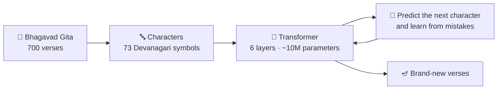

<div align="center">

# 🪔 shloka-gpt

### *A tiny GPT that learns Sanskrit from the Bhagavad Gita, from scratch*

**धर्मक्षेत्रे कुरुक्षेत्रे समवेता युयुत्सवः।**


</div>

---

## ✨ The idea

> **Can a small neural network, given nothing but the raw text of the Gita, discover the rules of Sanskrit on its own?**

No pre-trained model. No grammar rules. No dictionary.
The model starts knowing nothing, not even what a letter is, and learns purely by reading all **700 verses**, one Devanagari character at a time.

Sanskrit makes this a fascinating test:

| 🔗 **Sandhi** | Words fuse together at their edges, so there are no clean word boundaries to lean on |
|---|---|
| 🎼 **Metre** | Verses follow strict rhythms like the *anuṣṭubh*: four quarters of eight syllables |
| ✍️ **Script** | Devanagari builds syllables from consonants, vowel signs and conjuncts |

---

## 🧠 How it works



| | |
|---|---|
| **Model** | GPT-style Transformer, written from scratch in ~100 lines of plain PyTorch |
| **Tokens** | Single characters, so the model must discover syllables and words itself |
| **Data** | ~66,000 characters of the Gita in Devanagari |
| **Size** | ~10.8 million parameters (6 layers, 6 attention heads) |

---

## 📈 Watching it learn

Even a **tiny test model** after only **300 training steps** (a few seconds on a laptop CPU) already picks up the *shape* of a Gita verse: Devanagari syllables, the `।` and `।।` verse marks, and verse numbers:

```text
नस्रीदि वा द्रते स्यवनै
त्रैवा ह्यगोक्विन य स्मा।
पन्त्यहि सि मर्थ तः सत्विं च।7.3।
```

The full-size model trains for much longer and gets far closer to real metre.

**What to look for in the output:**

- ✅ valid Devanagari syllables and conjunct consonants
- ✅ verse-ending marks (`।` and `।।`) in the right places
- ✅ line lengths drifting towards the 8-syllable *anuṣṭubh* rhythm
- ✅ speaker lines like `श्रीभगवानुवाच` ("the Lord said")

---

## 🚀 Run it yourself

```bash
pip install torch
python train.py            # full training (NVIDIA GPU recommended)
python train.py --small    # quick test on any laptop CPU
python sample.py           # compose new verses
```

<details>
<summary><b>📁 Project structure</b></summary>

```
shloka-gpt/
├── model.py     ← the Transformer, built from scratch
├── train.py     ← teaches the model on the Gita
├── sample.py    ← asks the model to compose new verses
└── data/
    └── gita.txt ← all 700 verses in Devanagari
```

</details>

---

## 🗺️ Roadmap

- [x] Character-level GPT built from scratch
- [x] Training pipeline on the full Bhagavad Gita
- [ ] Compare early vs late training to see *when* metre emerges
- [ ] Syllable-level tokens instead of characters
- [ ] Train on more classical texts: Upanishads, Ramayana

---

## 🙏 Credits

- Verse text from the public-domain [gita/gita](https://github.com/gita/gita) dataset
- Model design inspired by Andrej Karpathy's educational GPT implementations

<div align="center">

**कर्मण्येवाधिकारस्ते मा फलेषु कदाचन ॥**
*"Your right is to the work alone, never to its fruits." (2.47)*

</div>
